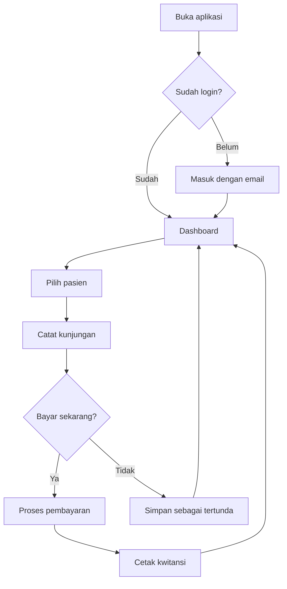

# Rakit.ai — Master Context & Handoff Document

> **Tujuan dokumen ini.** Ini adalah konteks master lintas-AI untuk proyek Rakit.ai. Dokumen ini
> ditulis agar bisa **disalin langsung** ke Confluence atau ditempel sebagai konteks awal ke
> ChatGPT, Gemini, Claude, atau asisten AI lain — tanpa perlu akses ke repository.
>
> **Aturan pemeliharaan.** Setiap kali arsitektur atau prioritas berubah (model LLM baru,
> layanan baru, tahap roadmap selesai, atau urutan prioritas bergeser), dokumen ini **wajib ikut
> diperbarui** dan dijaga konsisten dengan `CLAUDE.md`, `KNOWLEDGE_BASE.md`, `TODO.md`, dan
> `.amanah/atlas/*.md`. Bila dokumen ini dan kode berbeda, **kode menang** — lalu perbaiki
> dokumen ini.
>
> **Versi:** 2026-11-24 · **Status proyek:** monorepo berjalan, pra-MVP

---

## 1. Ringkasan Produk

**Rakit.ai** adalah platform low-code/no-code berbasis AI untuk pasar Indonesia. Pengguna
menuliskan ide aplikasi dalam bahasa sehari-hari — misalnya *"saya butuh sistem kasir untuk
klinik"* — dan platform menghasilkan skema database plus aplikasi full-stack yang berjalan,
lalu menerbitkannya ke Cloudflare.

Pengguna tidak menulis kode dan tidak mengonfigurasi infrastruktur.

### 1.1 Masalah yang diselesaikan

Pengguna datang dengan **ide**, bukan *design brief*. Mereka tidak membawa wireframe, palet
warna, atau spesifikasi komponen. Dua kegagalan yang paling sering terjadi:

1. **Kelumpuhan kanvas kosong** — tidak tahu harus mulai dari mana saat menghadapi editor
   kosong (paling terasa pada mahasiswa dan pemula).
2. **Beban teknis yang tidak sepadan** — menyiapkan server, database, dan styling menghabiskan
   waktu yang seharusnya dipakai untuk logika aplikasi (paling terasa pada freelancer).

Platform ini menyediakan struktur tersebut secara otomatis. Sejak 2026-11-24, arah produknya
juga menambahkan satu langkah sebelum generate: **menanyakan kebutuhan** alih-alih menebaknya.

### 1.2 Target pengguna

Tiga persona, **semuanya prioritas setara** untuk MVP:

| Persona | Kondisi | Yang menghambat |
|---------|---------|-----------------|
| **UMKM melek teknologi** | Pemilik usaha (toko, klinik) yang ingin digitalisasi, bukan developer | Menolak langganan bulanan berbayar USD dari platform asing |
| **Siswa SMK / mahasiswa IT** | Mengerjakan proyek akhir atau kerja freelance | Kelumpuhan kanvas kosong saat mulai mendesain |
| **Freelancer web lokal** | Mengambil banyak pesanan aplikasi kecil | Waktu habis untuk styling CSS serta setup server/database |

Rentang literasi teknis yang lebar itulah **batasan utama desain antarmuka**: satu permukaan
harus melayani orang yang belum pernah menyentuh database maupun yang menyentuhnya tiap minggu.
Kontrol lanjutan diungkap bertahap (*progressive disclosure*), tidak pernah diasumsikan.

### 1.3 Pembeda produk

Tiga hal yang harus tetap berjalan bersama — pesaing biasanya hanya memegang satu atau dua:

1. **Realitas pembayaran lokal** — target akhirnya prabayar Rupiah (QRIS / Virtual Account),
   bukan langganan bulanan USD. **Ditunda:** belum ada yang menagih hari ini, dan tidak ada
   antarmuka yang boleh menyiratkan sebaliknya.
2. **Latensi edge & infrastruktur Cloudflare** — Pages, Workers, dan D1 yang disediakan per
   proyek, bukan backend multi-tenant bersama.
3. **Generasi terbatas (*constrained generation*)** — LLM **tidak pernah** mengeluarkan HTML
   atau JavaScript. Ia mengembalikan JSON yang divalidasi Zod dan hanya dipetakan ke pustaka
   komponen yang di-whitelist. Komponen tak dikenal ditolak.

Poin 3 adalah mekanisme yang tidak bisa ditiru pesaing tanpa membangun ulang pipeline
generasinya. Itu juga satu-satunya poin yang sudah sepenuhnya dibangun hari ini.

---

## 2. Arsitektur Workspace

Monorepo dengan **npm workspaces**. Tiga workspace, satu kontrak bersama.

```
D:\PKL\Project
├── apps/editor/          @rakit/editor        Vite + React + Tailwind + Zustand
├── apps/orchestrator/    @rakit/orchestrator  Hono + TypeScript; klien LLM, rute, layanan, D1
├── packages/schema/      @rakit/schema        Kontrak Zod, dipakai kedua app
├── tools/                Harness dev (dev-all.mjs, fake-llm.mjs) — tidak dipublikasikan
├── docs/                 Dokumen handoff lintas-AI (dokumen ini)
├── .amanah/atlas/        Peta konteks arsitektur (product, tech, structure, conventions, quickstart)
└── .amanah/blueprints/   Blueprint fitur (riwayat + rencana)
```

### 2.1 `apps/editor` — antarmuka pengguna

- **Stack:** Vite + React 18 + Tailwind CSS + Zustand.
- **State:** seluruh state dan aksi editor hidup di satu store, `src/store/useBuilder.ts`.
  Komponen membaca lewat selector; tidak ada lapisan service terpisah di editor.
- **Seam HTTP:** `src/lib/api.ts` — satu-satunya jalur ke orchestrator.
- **Mapper JSON → komponen:** `components/preview/Preview.tsx`, bercabang pada `block.kind`.
- **Editor visual gratis:** `components/inspector/Inspector.tsx` — klik untuk mengubah teks,
  warna aksen, dan salinan. **Tidak pernah** menghitung biaya; ini janji produk, bukan
  optimisasi.
- **Navigasi:** **tidak ada router.** View diganti lewat field `view` di store
  (`'builder' | 'schema'`). Konsekuensinya: tidak ada URL yang bisa dibagikan, dan reload
  kehilangan konteks.
- **Port dev:** 5180 dengan `strictPort: true` — instance kedua gagal, bukan pindah port.

### 2.2 `apps/orchestrator` — backend & orkestrasi AI

- **Stack:** Hono di Cloudflare Workers (TypeScript).
- **Dua entry point, satu app:** `src/worker.ts` (target deploy Cloudflare) dan `src/server.ts`
  (Node + `tsx watch`, port 5181, untuk inner loop cepat). Keduanya hanya membangun
  `createApp()` dari `src/app.ts`; tidak ada routing atau logika bisnis di entry point.
- **Konfigurasi:** lewat objek `Env` eksplisit, **bukan** `process.env`. Inilah yang membuat
  kode yang sama jalan di dua runtime tanpa polyfill `nodejs_compat`.
- **Layanan:** `src/services/generation.ts` mengorkestrasi generate dan revisi.
- **Klien LLM:** `src/llm/openai-compatible-client.ts` (kompatibel OpenAI), dengan timeout
  eksplisit.
- **Prompt:** `src/prompt/system-prompt.ts` — dibangun dari konstanta kontrak, bukan literal
  yang disalin.
- **Persistensi:** `src/repositories/projects.ts` + `migrations/` di D1 `rakit-db`.

### 2.3 `packages/schema` — kontrak bersama

- **Satu-satunya rumah whitelist komponen.** `WHITELISTED_KINDS` dan skema Zod hidup di sini
  dan dibaca oleh system prompt maupun mapper.
- Diimpor sebagai sumber (`"main": "./src/index.ts"`), **bukan** dibangun ke `dist/`. Tidak ada
  langkah build antar paket.
- `apps/editor/src/lib/contract.ts` dan `parse.ts` adalah **shim re-export**, bukan salinan.
  Duplikasi akan memberi whitelist dua rumah dan membuatnya melenceng.
- **Penegakan aturan #1:** `kind` adalah `refine` atas whitelist (bukan `z.enum`) agar pesan
  galat bisa menyebut nilai yang ditolak; `parse.ts` mengambil nilai tersebut dari payload
  mentah.

### 2.4 Alur data

```
Editor (React)  ──HTTP──>  Orchestrator (Hono)
     │                          │
     │                          ├─> System prompt ← @rakit/schema (whitelist)
     │                          ├─> LLM-Kita (gpt-6-luna)
     │                          ├─> Ekstraksi JSON
     │                          ├─> Validasi Zod (@rakit/schema)
     │                          └─> D1 (rakit-db): projects + project_revisions
     │
     └─<── JSON tervalidasi ──> Preview.tsx (mapper) ──> komponen whitelist
```

### 2.5 Aturan non-negosiabel (ringkas)

1. **LLM tidak pernah mengeluarkan HTML/JS.** Output JSON, divalidasi Zod, dipetakan hanya ke
   komponen whitelist. Tolak komponen tak dikenal.
2. **Platform tidak mengukur pemakaian.** Tidak ada koin, saldo, ledger, atau penyedia
   pembayaran di MVP. Jangan tampilkan saldo, harga, atau tombol "top up".
3. **Revisi mempertahankan `id` proyek.** `reviseProject` tidak pernah membuat id baru.
4. **Satu database D1 per proyek pengguna.** Tidak ada tabel lintas-tenant. `rakit-db` hanya
   metadata platform, tidak pernah data aplikasi pengguna.
5. **Tidak ada rahasia di kode.** Hanya env var / Cloudflare secret. `VITE_*` **bukan** rahasia
   — Vite menanamkannya ke bundle browser.
6. **Semua panggilan eksternal punya timeout eksplisit.**

---

## 3. Status Riil Fitur (per 2026-11-24)

Dokumen ini membedakan dengan tegas **apa yang berjalan end-to-end** dari **apa yang masih
simulasi atau terbatas**. Jangan menyebut sesuatu "selesai" bila ia ada di kolom kanan.

### 3.1 Angka kunci hari ini

| Metrik | Nilai |
|--------|-------|
| Model LLM aktif | **`gpt-6-luna`** (`LLM_KITA_MODEL`, di `wrangler.toml`) |
| Unit test | **288 test** di 17 file — 231 orchestrator + 34 schema + 23 editor |
| Typecheck | Bersih (`tsc --noEmit`) di ketiga workspace |
| Verifikasi generate + revisi | **End-to-end, lokal, terhadap provider asli** |

### 3.2 Berjalan end-to-end

| Fitur | Bukti / Lokasi |
|-------|----------------|
| CRUD proyek dengan persistensi D1 | `/api/v1/projects`, `repositories/projects.ts` |
| **Generate**: prompt → LLM → validasi → D1 → editor | `services/generation.ts`, `useBuilder.runGeneration` |
| **Revisi**: instruksi → proyek baru, `id` dipertahankan, riwayat ditulis | `services/generation.ts`, `reviseProject` |
| Validasi kontrak Zod atas seluruh output LLM | `packages/schema/src/contract.ts` |
| Penolakan (*refusal*) model ditangani sebagai jawaban sah, bukan error | `llmEnvelopeSchema` union |
| Pesan galat kontrak menyebut path field dan nilai yang ditolak | `parse.ts` (`toIssues()`) |
| Editor visual gratis (teks, aksen, salinan) | `components/inspector/Inspector.tsx` |
| Dua view editor (builder, skema) + empty state nol-proyek | `App.tsx`, `components/views/` |
| CORS allowlist (fail-closed) + gerbang token bersama | `src/cors.test.ts`, `src/worker.test.ts` |
| `FEATURE_GENERATE_ENABLED` — `/generate` & `/revise` 503 bila tidak persis `"true"` | `wrangler.toml`, middleware |

### 3.3 Masih simulasi atau terbatas

| Keterbatasan | Kondisi riil | Dampak ke pengguna |
|--------------|--------------|--------------------|
| **Pustaka komponen hanya 3 kind** | `WHITELISTED_KINDS = ['navbar', 'stat', 'table']` | Tidak ada form, card, list, atau chart — aplikasi hasil generate selalu berbentuk sama |
| **Baris tabel di-hardcode** | `Preview.tsx` merender konstanta `ROWS` (4 baris klinik: "Siti Rahmawati", dst.) | Isi tabel **tidak pernah** mencerminkan prompt; semua proyek menampilkan data yang sama |
| **Publish masih simulasi** | `runPublish` = rantai `setTimeout` + set `status: 'live'` | Tidak ada database/Worker/Pages yang benar-benar dibuat |
| **Belum ada generator DDL** | `packages/generator/` tidak ada | Skema proyek belum bisa menjadi `CREATE TABLE` |
| **Belum ada Auth** | `owner_id` masih placeholder (`'local-user'`) | Semua pemanggil melihat data yang sama; API tidak boleh dipublikasikan |
| **Progres generasi adalah timer** | Tahap di UI dimajukan `setTimeout`, bukan progres server | Progres yang tampil tidak mencerminkan pekerjaan nyata |
| **Belum ada Chief of Staff** | Belum ada sesi tanya-jawab; input masih satu kotak prompt | Pengguna masih harus menebak sendiri detail kebutuhannya |
| **Belum ada PRD/Mermaid** | Tidak ada dependensi `mermaid` di repo | Tidak ada artefak antara prompt dan layar yang dihasilkan |
| **Belum ada rate limiting / kuota per pengguna** | — | Penahan biaya satu-satunya adalah `FEATURE_GENERATE_ENABLED` |

### 3.4 Kendali akses — pengekangan, bukan autentikasi

Dua lapis melindungi kuota LLM pada Worker yang sudah di-deploy. **Tidak satu pun autentikasi
sungguhan**, dan jangan pernah mendeskripsikannya sebagai auth:

- **`FEATURE_GENERATE_ENABLED`** — `/generate` dan `/revise` membalas **503 `FEATURE_DISABLED`**
  kecuali nilainya persis `"true"`. **Mati secara default**, termasuk bila tidak di-set. Ini
  lapis yang benar-benar bekerja: hidup di environment Worker dan tidak bisa dibaca klien.
- **`RAKIT_SHARED_TOKEN`** — semua rute kecuali `/health` dan preflight CORS memerlukan
  `X-Rakit-Token` yang cocok. Ini **pengekangan, bukan autentikasi**: editor adalah aplikasi
  browser, jadi Vite menanam tokennya ke bundle dan terbaca di DevTools. Ia menghalangi crawler
  dan scanner, tidak lebih.

`/health` sengaja terbuka: tidak membelanjakan token dan hanya melaporkan apakah kunci LLM ada,
sehingga operator bisa membedakan "Worker mati" dari "token saya salah".

---

## 4. Peta Jalan & Prioritas (Keputusan Meeting Mentor 2026-11-24)

### 4.1 Perubahan keputusan

**Auth digeser ke belakangan.** Ia **bukan lagi blocker P0**. Alasannya:

- Risiko teknis sudah tertahan oleh `FEATURE_GENERATE_ENABLED` + `RAKIT_SHARED_TOKEN` selama
  deployment tidak dipublikasikan.
- Celah yang jauh lebih terlihat adalah **kualitas produk**: preview hanya punya 3 block kind
  dan baris tabelnya hardcoded, sehingga hasil generate terasa seperti demo — bukan seperti
  aplikasi yang dibuat untuk ide pengguna.

Auth **ditunda, bukan dibatalkan**: ia wajib selesai sebelum platform dipublikasikan atau
diisi pengguna nyata, dan ia yang membuka jalan untuk rate limiting per pengguna.

### 4.2 Urutan prioritas yang berlaku

```
(1) Login          — auth BELAKANGAN (pengekangan saat ini memadai)
 └─> (2) Editor    — kanvas kerja yang sudah ada
      └─> (3) AI Chief of Staff — tanya-jawab terstruktur menggali kebutuhan user
           └─> (4) PRD + diagram Mermaid (user flow)
                └─> (5) Generate website end-to-end dengan konten RICH
                     └─> (6) Integrasi deploy Cloudflare Pages/D1 (kini simulasi)
```

| # | Tahap | Status | Inti pekerjaan |
|---|-------|--------|----------------|
| 1 | Login / auth | **Ditunda** | Selesaikan sebelum go-public |
| 2 | Editor | **Berjalan** | Kanvas, inspector, 2 view, persistensi D1 |
| 3 | **AI Chief of Staff** | **Belum ada** | Sesi tanya-jawab terstruktur (§5) |
| 4 | **PRD + Mermaid** | **Belum ada** | Dokumen PRD + diagram user flow (§5.4) |
| 5 | **Generate rich** | **Sebagian** | Perluas whitelist; alirkan data tabel nyata (§5.5) |
| 6 | **Deploy nyata** | **Simulasi** | Generator DDL + API Cloudflare |

### 4.3 Mengapa tahap 5 mendesak

Dua batasan konkret yang harus diatasi, keduanya terlihat langsung oleh pengguna:

1. **`WHITELISTED_KINDS` hanya `navbar`, `stat`, `table`.** Tidak ada form (pengguna tidak bisa
   memasukkan data), card, list, atau chart. Setiap aplikasi yang dihasilkan terlihat serupa.
2. **`TableBlock` merender konstanta `ROWS`.** Empat baris klinik yang sama muncul di setiap
   proyek, apa pun prompt-nya. Tabel adalah satu-satunya kind yang menampilkan "data", dan
   datanya palsu dan tidak berubah.

Menambah kind bukan pekerjaan satu file: kind baru harus masuk `WHITELISTED_KINDS`, punya
renderer di `Preview.tsx`, punya data seed, **dan** disebut di system prompt — bila tidak,
skema menerima kind yang tidak dirender (tak bisa dibedakan dari bug).

---

## 5. Spesifikasi "AI Chief of Staff"

Bagian ini adalah **spesifikasi perilaku** untuk tahap 3 dan 4. Fitur ini belum dibangun;
spesifikasi ini adalah acuan implementasi, bukan deskripsi kode yang ada.

### 5.1 Tujuan

Menutup celah antara "satu kalimat deskripsi" dan "kebutuhan yang sebenarnya". Pengguna datang
dengan ide, bukan *design brief*. Chief of Staff berperan sebagai analis produk yang menggali
kebutuhan lewat pertanyaan terarah, lalu menghasilkan artefak yang bisa dibaca manusia **dan**
dipakai mesin untuk generate.

**Prinsip:** bertanya, jangan menebak. Setiap asumsi yang tidak dikonfirmasi adalah bagian dari
aplikasi yang mungkin salah dibangun.

### 5.2 Aturan tanya-jawab

| Aturan | Ketentuan |
|--------|-----------|
| **Jumlah pertanyaan** | **Maksimal 3–5 pertanyaan per putaran.** Lebih dari itu membuat pengguna berhenti; lebih sedikit menyisakan kebutuhan yang tidak tergali |
| **Kualitas pertanyaan** | **Tajam dan spesifik** — pertanyaan yang jawabannya mengubah keputusan desain. Bukan "fitur apa saja yang Anda inginkan?" |
| **Jumlah putaran** | Berhenti begitu informasi cukup untuk PRD yang lengkap. Jangan bertanya demi terlihat menyeluruh |
| **Format** | Pertanyaan bernomor, masing-masing satu baris, dengan contoh jawaban singkat bila pertanyaannya abstrak |
| **Bahasa** | Bahasa Indonesia, sesuai bahasa pengguna dan seluruh salinan UI |
| **Tanpa asumsi senyap** | Bila model terpaksa mengasumsikan sesuatu, asumsi itu **ditulis eksplisit** di PRD pada bagian asumsi |
| **Dapat dilewati** | Pengguna boleh menjawab "terserah" / melewati; Chief of Staff mengambil default yang wajar dan mencatatnya sebagai asumsi |

**Contoh pertanyaan yang tajam** (untuk ide "sistem kasir klinik"):

1. Siapa yang memakai sistem ini setiap hari — satu resepsionis, atau beberapa staf dengan peran
   berbeda (dokter, kasir, apoteker)?
2. Apakah pembayaran dicatat per kunjungan, atau per item layanan/obat yang diambil?
3. Apakah stok obat perlu berkurang otomatis saat transaksi, atau dicatat terpisah?
4. Data apa yang paling sering dicari saat membuka aplikasi di pagi hari?
5. Apakah ada laporan yang harus dicetak atau diekspor setiap bulan?

Setiap pertanyaan di atas mengubah keputusan skema (peran → tabel pengguna; per kunjungan vs per
item → bentuk tabel transaksi; stok otomatis → relasi dan trigger) — itulah ukuran "tajam".

**Contoh pertanyaan yang tidak tajam** (hindari): *"Apa saja fitur yang Anda butuhkan?"*,
*"Bagaimana tampilan aplikasi yang Anda inginkan?"*, *"Apakah Anda ingin aplikasi yang bagus?"*.
Ketiganya memindahkan pekerjaan analisis kembali ke pengguna — persis masalah yang ingin
diselesaikan.

### 5.3 Alur sesi

```
Ide awal (1 kalimat)
   │
   ├─> Putaran 1: 3–5 pertanyaan tajam  ──> jawaban pengguna
   ├─> Putaran 2: 3–5 pertanyaan lanjutan (hanya bila masih ada celah)
   ├─> ... (berhenti saat cukup)
   │
   ├─> PRD lengkap (§5.4 bagian A)
   ├─> Diagram Mermaid user flow (§5.4 bagian B)
   └─> Objek kebutuhan terstruktur (mesin) ──> tahap generate rich (§5.5)
```

Objek kebutuhan terstruktur itu yang menggantikan "prompt satu kalimat" sebagai input tahap
generate. Ia harus memuat setidaknya: aktor/peran, entitas data, aksi utama per aktor, aturan
bisnis yang dikonfirmasi, dan daftar asumsi eksplisit.

### 5.4 Format output

**A. PRD lengkap** — dokumen yang bisa dibaca pemilik usaha, bukan hanya developer:

1. **Ringkasan** — satu paragraf: aplikasi apa, untuk siapa, masalah apa yang diselesaikan.
2. **Aktor & peran** — siapa memakai apa, dan hak aksesnya.
3. **Alur pengguna utama** — langkah demi langkah untuk tugas harian yang paling sering.
4. **Entitas data** — tabel, kolom penting, dan relasi antar tabel (bahasa manusia, bukan DDL).
5. **Aturan bisnis** — hal yang harus selalu atau tidak boleh terjadi (mis. "stok tidak boleh
   minus").
6. **Layar yang dibutuhkan** — daftar layar beserta tujuan masing-masing.
7. **Di luar cakupan** — secara eksplisit apa yang **tidak** akan dibangun, agar harapan
   terkelola.
8. **Asumsi** — semua hal yang tidak dikonfirmasi pengguna dan diputuskan oleh sistem.

**B. Diagram Mermaid user flow** — satu diagram alur utama, dalam blok kode `mermaid`:

````markdown

````

Ketentuan diagram: **satu alur utama** (bukan semua kemungkinan), node diberi label bahasa
Indonesia yang dimengerti pemilik usaha, keputusan memakai `{...}`, dan jumlah node dijaga
wajar (±10–15) agar tetap terbaca. Bila ada dua peran dengan alur berbeda, gunakan maksimal dua
diagram terpisah.

**Catatan keamanan:** sumber Mermaid adalah **output model**, bukan markup tepercaya. Validasi
dan escape sebelum dirender; jangan pernah menaruhnya lewat `dangerouslySetInnerHTML`.

### 5.5 Standar output tahap generate (konten rich)

PRD dan diagram hanyalah alat; yang dinilai pengguna adalah aplikasi hasil generate. Standar
minimum agar hasilnya terasa "aplikasi nyata", bukan demo:

| Aspek | Standar | Kondisi hari ini |
|-------|---------|------------------|
| **Keragaman komponen** | Setiap layar memakai kombinasi minimal 2–3 kind berbeda; layar daftar memakai tabel/list, layar detail memakai card, layar input memakai form | Hanya `navbar`, `stat`, `table` |
| **Data tabel nyata** | Baris tabel berasal dari dokumen proyek (seed yang relevan dengan domain), bukan konstanta | Konstanta `ROWS` berisi data klinik di semua proyek |
| **Kekayaan isi** | Judul, label kolom, dan isi sel memakai istilah domain dari PRD — bukan lorem ipsum atau istilah generik | Sebagian: judul dari model, isi tabel selalu sama |
| **Konsistensi antar layar** | Navigasi menyebut layar yang benar-benar ada; tidak ada tautan ke layar hantu | Navbar hanya teks, tidak ada tautan |
| **Kepadatan yang wajar** | Setiap layar punya cukup isi sehingga tidak terlihat kosong saat dibuka | Bergantung pada jumlah blok yang dihasilkan model |
| **Angka & status yang masuk akal** | Nilai `stat` konsisten dengan isi tabel di layar yang sama | Tidak dijamin |

**Definisi selesai untuk tahap 5:** sebuah prompt UMKM nyata menghasilkan aplikasi yang, tanpa
diedit, memperlihatkan minimal dua jenis komponen berbeda per layar, tabel dengan baris yang
relevan dengan domain, dan tidak ada satu pun data placeholder yang tertinggal dari demo lama.

### 5.6 Batasan yang harus dihormati Chief of Staff

- **Tidak boleh** mengeluarkan HTML/JS — sama seperti generate. Output tetap JSON tervalidasi.
- **Harus** melewati `FEATURE_GENERATE_ENABLED`: satu sesi adalah beberapa panggilan LLM dan
  membelanjakan kuota yang sama dengan `/generate`.
- **Harus** punya timeout eksplisit per panggilan (`LLM_TIMEOUT_MS` atau turunannya).
- **Tidak boleh** menjanjikan fitur yang tidak ada di roadmap (mis. pembayaran online,
  notifikasi WhatsApp) kecuali pengguna memintanya sebagai di luar cakupan.

---

## 6. Stack & Keputusan Teknis yang Terkunci

| Lapisan | Pilihan |
|---------|---------|
| Frontend editor | Vite + React + Tailwind CSS + Zustand (Cloudflare Pages) |
| Backend inti | Hono di Cloudflare Workers (TypeScript) |
| Mesin AI | API LLM-Kita, model **`gpt-6-luna`**, output JSON ketat |
| DB platform | Cloudflare D1 (`rakit-db`) — metadata proyek + riwayat revisi |
| DB proyek pengguna | Cloudflare D1, satu per proyek — **belum disediakan** |
| Komputasi proyek pengguna | Cloudflare Workers — **belum disediakan** |
| Pembayaran | Tidak ada. Billing ada di akun LLM-Kita. |

**Catatan model:** `gpt-6-luna` menggantikan placeholder `auto` pada 2026-11-24 dan merupakan
model yang dipakai saat verifikasi end-to-end generate + revisi. Mengganti model membatalkan
verifikasi itu — jalankan ulang, karena system prompt disetel terhadap bentuk output model ini.
Jangan mengarang id model; `kita-default` pernah dikarang saat setup dan tidak pernah ada.

**Catatan API LLM-Kita:** API ada di `https://api.llm-kita.com/api/v1`, **bukan** situs
marketing `https://llm-kita.com` yang membalas setiap `POST` dengan **405**. `LLM_KITA_BASE_URL`
harus menyertakan `/api/v1`; klien menambahkan `/chat/completions`.

---

## 7. Persistensi & Data

Satu database D1 (`rakit-db`) menyimpan **metadata platform saja**:

- **`projects`** — `id`, `owner_id` (placeholder), `name`, `slug`, `prompt`, `status`,
  `document` (JSON), `revision`, `created_at`, `updated_at`
- **`project_revisions`** — riwayat; setiap baris mencatat keadaan *setelah* satu revisi

Aturan: revisi mempertahankan `id` proyek; satu D1 per proyek pengguna; data aplikasi pengguna
tidak pernah masuk `rakit-db`. Migrasi ada di `apps/orchestrator/migrations/`.

Batasan D1 yang akan menggigit saat generator DDL ditulis: tidak ada `SERIAL`, tidak ada
sequence, `ALTER TABLE` terbatas. Gunakan `INTEGER PRIMARY KEY AUTOINCREMENT` atau id TEXT, dan
rebuild tabel alih-alih `ALTER COLUMN`.

---

## 8. Format Respons API

- Sukses: `{ data, error: null }` dengan status 2xx.
- Gagal: `{ data: null, error: { code, message, details } }`.
- `code` adalah token UPPER_SNAKE yang stabil — klien bercabang pada `code`, **tidak pernah**
  pada pesan manusia.

Kode yang ada: `UNSUPPORTED_MEDIA_TYPE`, `PAYLOAD_TOO_LARGE`, `INTERNAL_ERROR`, `NOT_FOUND`,
`UNAUTHORIZED`, `DATABASE_UNAVAILABLE`, `FEATURE_DISABLED`, `CONTRACT_VIOLATION`,
`INVALID_SCHEMA`, `REVISION_DROPPED_DATA`, serta `LLM_TIMEOUT`, `LLM_RATE_LIMITED`,
`LLM_MALFORMED`, `LLM_UNAVAILABLE`.

Perhatikan: **401/403 dari provider dilaporkan sebagai 502 `LLM_UNAVAILABLE`, bukan 401 klien** —
yang ditolak adalah API key *kita*, dan pengguna tidak bisa berbuat apa-apa. Kegagalan validasi
atas jawaban model adalah **422 `INVALID_SCHEMA`** (permintaan baik, jawaban model tidak
terpakai, coba lagi bisa berhasil); `details` menyebut `path` field dan nilai yang ditolak.
Jangan pernah bocorkan stack trace, galat SQL, atau isi galat provider ke klien.

---

## 9. Konvensi Kerja

| Hal | Aturan |
|-----|--------|
| Bahasa salinan UI | **Indonesia** |
| Bahasa identifier & komentar kode | **Inggris** |
| Nama file komponen | PascalCase (`SchemaView.tsx`) |
| Nama file modul | kebab-case (`openai-compatible-client.ts`) |
| Nama tabel DB | snake_case, plural (`projects`) |
| Konstanta | UPPER_SNAKE (`WHITELISTED_KINDS`) |
| Zod schema | camelCase + `Schema` (`projectSchema`) |
| Verifikasi sebelum commit | `npm test` + `npm run typecheck` |

**Dilarang:** `dangerouslySetInnerHTML`, `eval`, `new Function` di mapper; menyambung teks prompt
ke SQL atau template Worker; menaruh API key di repo/blueprint/kode Worker hasil generate;
menambah komponen tanpa menambahkannya ke whitelist **dan** system prompt; menampilkan saldo,
harga, atau tombol "top up".

**Verifikasi tata letak:** screenshot di 1440 / 1280 / 1024 px sebelum mengklaim layout beres.

---

## 10. Perintah Penting

```bash
# Dari root
npm run dev:all        # editor (:5180) + orchestrator (:5181) bersama
npm test               # vitest di semua workspace — 288 test
npm run typecheck      # tsc --noEmit di semua workspace
npm run fake-llm       # provider LLM palsu, tanpa API key
npm run smoke          # smoke end-to-end terhadap provider palsu
npm run check:branches # penjaga invarian ID-preservation

# Dari apps/orchestrator/
npm run dev              # Node + tsx watch, :5181 — inner loop cepat
npm run dev:worker       # wrangler dev, :8787 — isolate workerd asli
npm run db:migrate:local # terapkan migrasi ke D1 lokal
npm run deploy           # wrangler deploy

# Dokumentasi → Confluence
node scripts/sync-confluence.mjs            # dry run
node scripts/sync-confluence.mjs --apply    # publikasikan
```

---

## 11. Yang Sengaja Tidak Ada

Jangan bangun ulang tanpa keputusan eksplisit:

- **Sistem koin, ledger, saldo, Midtrans.** Dihapus sebagai kode mati. Model bisnisnya
  **ditunda**, bukan dibatalkan — masih ada di PRD. Jangan tampilkan saldo, harga, atau tombol
  "top up", karena tidak ada yang menagih.
- **Express.js / `apps/api/`.** Backend adalah Hono di Workers. Tidak akan ada `apps/api/`.
- **Router di editor.** Navigasi lewat state; hanya `builder` dan `schema` yang ada.
- **View `ledger`.** Sudah dihapus bersama sistem koin.

---

## 12. Dokumen Terkait di Repository

| Butuh… | Lihat |
|--------|-------|
| Aturan agen + non-negosiabel | `CLAUDE.md` |
| Ringkasan arsitektur yang terpasang | `KNOWLEDGE_BASE.md` |
| Daftar tugas & prioritas | `TODO.md` |
| Definisi produk & persona | `PRODUCT.md` |
| Kebutuhan lengkap (termasuk billing) | `prd_ai_first_app_builder.md` |
| Peta konteks arsitektur | `.amanah/atlas/{product,tech,structure,conventions,quickstart}.md` |
| Rencana fitur per fitur | `.amanah/blueprints/{feature}/` |
| Spesifikasi permukaan UI | `.impeccable/surfaces/editor-builder.md` |

---

## 13. Ringkasan Satu Paragraf (untuk konteks cepat)

Rakit.ai adalah app builder AI untuk Indonesia: satu deskripsi bahasa alami menghasilkan skema
database dan aplikasi full-stack yang diterbitkan ke Cloudflare. Monorepo-nya terdiri dari
editor React (`apps/editor`), orchestrator Hono di Cloudflare Workers (`apps/orchestrator`), dan
kontrak Zod bersama (`packages/schema`). Hari ini yang berjalan end-to-end adalah CRUD proyek di
D1, generate dan revisi melalui LLM-Kita dengan model `gpt-6-luna` dan validasi Zod, editor
visual gratis, serta 288 unit test yang hijau. Yang masih simulasi atau terbatas: publish
(baru `setTimeout`), pustaka komponen (hanya `navbar`, `stat`, `table`, dengan baris tabel
hardcoded), autentikasi (ditunda sesuai keputusan mentor 2026-11-24), generator DDL, dan
provisioning Cloudflare per proyek. Prioritas berikutnya adalah membangun AI Chief of Staff —
sesi tanya-jawab terstruktur 3–5 pertanyaan tajam per putaran — yang menghasilkan PRD lengkap
plus diagram Mermaid user flow, lalu memakai hasilnya untuk generate website end-to-end dengan
konten rich, dan akhirnya mengganti publish simulasi dengan integrasi Cloudflare Pages/D1
sungguhan.
